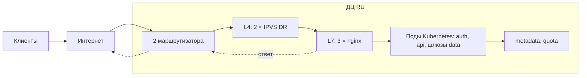
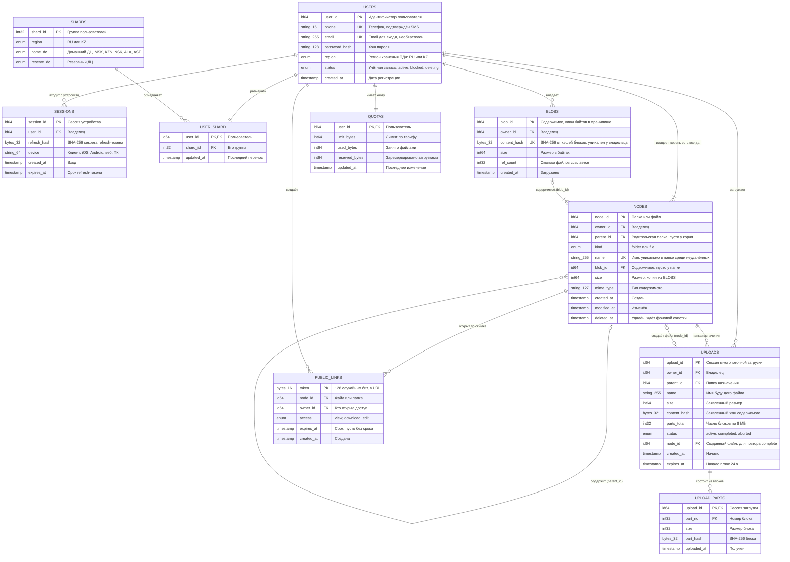

# Расчётно-пояснительная записка

**Дисциплина:** Проектирование высоконагруженных систем
**Тема проекта:** Проектирование бэкенда высоконагруженного B2C-сервиса облачного хранения данных на примере «Облако Mail»

---

## Оглавление

1. [Тема и целевая аудитория](#глава-1-тема-и-целевая-аудитория) ✅
2. [Оценка нагрузки (RPS, объёмы данных, трафик)](#глава-2-оценка-нагрузки-rps-объёмы-данных-трафик) ✅
3. [Глобальная балансировка нагрузки (GSLB)](#глава-3-глобальная-балансировка-нагрузки-gslb) 🔄
4. [Локальная балансировка нагрузки (LSLB)](#глава-4-локальная-балансировка-нагрузки-lslb) ✅
5. [Логическая схема БД](#глава-5-логическая-схема-бд) 🔄
6. Масштабирование и шардирование 
7. Обеспечение отказоустойчивости
8. Кэширование
9. Верхнеуровневая архитектура системы
10. Мониторинг и эксплуатация
11. Итоговая архитектурная схема и выводы

---

## Глава 1. Тема и целевая аудитория

### 1.1 Тема проекта, рыночная ниша и аналоги

**Выбранная тема:** проектирование бэкенда высоконагруженного B2C-облачного хранилища данных на примере сервиса **«Облако Mail»**.

**Реальные аналоги:** Google Drive, Apple iCloud, Dropbox, Microsoft OneDrive, Яндекс Диск. Наличие пяти независимых глобальных и локальных игроков на протяжении последних 10–15 лет однозначно подтверждает существование устойчивой и крупной рыночной ниши — потребности массового пользователя в резервном копировании фото/видео с мобильных устройств, синхронизации файлов между устройствами и обмене контентом по ссылке.

### 1.2 Целевая аудитория: размер и локализация

Целевая аудитория — массовый пользователь мобильных устройств и ПК, использующий сервис для автозагрузки фото/видео, резервного копирования и обмена файлами. Основной рынок — **Россия**, исторически значимая доля также приходилась на русскоязычных пользователей стран СНГ.

| Метрика | Значение | Период | Источник |
|---|---|---|---|
| MAU «Облако Mail» (Россия, 12+) | **21,2 млн** (1 пол. 2026); 14,6 млн — отдельно за 2 кв. 2026 | 1 пол. 2026, данные Mediascope | [Презентация результатов VK за 2 кв. 2026](https://corp.vkcdn.ru/media/files/rus_results_presentation_q2_2026.pdf) |
| Общий объём пользовательских данных | 335 ПБ | Февраль 2025 | [Habr: итоги «Облака Mail»](https://habr.com/ru/news/887932/) |
| Хранится уникальных файлов | 45,5 млрд | Февраль 2025 | [Habr: итоги «Облака Mail»](https://habr.com/ru/news/887932/) |
| Загружено файлов за отчётный период | 5,8 млрд (+17% г/г) | 2025 | [Habr: итоги «Облака Mail»](https://habr.com/ru/news/887932/) |
| Уникальных фотографий | 28 млрд (70 ПБ, +50% г/г) | Февраль 2025 | [Habr: итоги «Облака Mail»](https://habr.com/ru/news/887932/) |
| Хранимых видеофайлов | 2,5 млрд | Февраль 2025 | [Habr: итоги «Облака Mail»](https://habr.com/ru/news/887932/) |
| Исторический объём инфраструктуры (10-летие сервиса) | 600 ПБ (рост в 32 раза за 10 лет); 30 млрд файлов загружено за год | Итоги 2023 (август 2023) | [Официальный пресс-релиз VK](https://vk.company/ru/press/releases/11571/) |
| Подписчики единой подписки Mail Space (Почта + Облако) | > 3,2 млн, выручка +106% г/г (2025); > 3,6 млн, +97% г/г (1 кв. 2026) | 2025 / 1 кв. 2026 | [Пресс-релиз VK за 4 кв. и 12 мес. 2025](https://vk.company/ru/press/releases/12255/) |
| Общая аудитория интернета в России (контекст TAM) | 105 млн (86% населения 12+) | Октябрь 2025 | [Mediascope, презентация](https://mediascope.net/upload/iblock/539/zgazi40m8k99k5nfm21x50rfx31xdui4/%D0%9D%D0%A0%D0%A4_Mediascope_%D0%90%D1%83%D0%B4%D0%B8%D1%82%D0%BE%D1%80%D0%B8%D1%8F_%D0%98%D0%BD%D1%82%D0%B5%D1%80%D0%BD%D0%B5%D1%82%D0%B0.pdf) |

> Полный реестр квартальной отчётности VK, из которой взяты первичные данные: [vk.company/ru/investors/results](https://vk.company/ru/investors/results/#quarterlyResults).

### 1.3 Функционал MVP

Для проектирования выделены следующие **6 ключевых функций**, покрывающих полный жизненный цикл файла — от поступления с устройства клиента до совместного доступа через публичный интернет:

1. **Многопоточная загрузка файлов.** Клиент разбивает файл на блоки и загружает их параллельно;
2. **Регистрация и авторизация** Система авторизации пользователя и регистрация новых;
3. **Эмуляция виртуальной файловой системы.** Создание, переименование, перемещение и удаление папок;
4. **Публичный доступ по ссылке и контроль прав.** Генерация токенов доступа с ограничением срока действия и уровня прав (просмотр / редактирование / скачивание);
5. **Управление дисковой квотой (Оверквота).** Кросс-сервисный микросервис учёта занятого пространства Облака;
6. **Скачивание файлов.** Пользователь скачивает файлы из Облака;

### 1.4 Источники

- Официальные пресс-релизы и квартальная отчётность VK: [vk.company/ru/investors/results](https://vk.company/ru/investors/results/#quarterlyResults)
- Пресс-релиз VK «Объём пользовательских данных в Облаке Mail.ru увеличился за десять лет в 32 раза» (2023): [vk.company/ru/press/releases/11571](https://vk.company/ru/press/releases/11571/)
- Пресс-релиз VK по результатам за 4 кв. и 12 мес. 2025 (Mail Space): [vk.company/ru/press/releases/12255](https://vk.company/ru/press/releases/12255/)
- Презентация результатов VK за 2 кв. 2026 (MAU «Облако Mail», методология Mediascope): [corp.vkcdn.ru](https://corp.vkcdn.ru/media/files/rus_results_presentation_q2_2026.pdf)
- Habr — итоги «Облака Mail» за февраль 2025 (объём данных, число файлов/фото/видео): [habr.com/ru/news/887932](https://habr.com/ru/news/887932/)
- Mediascope — официальная презентация «Аудитория интернета» (октябрь 2025): [mediascope.net](https://mediascope.net/upload/iblock/539/zgazi40m8k99k5nfm21x50rfx31xdui4/%D0%9D%D0%A0%D0%A4_Mediascope_%D0%90%D1%83%D0%B4%D0%B8%D1%82%D0%BE%D1%80%D0%B8%D1%8F_%D0%98%D0%BD%D1%82%D0%B5%D1%80%D0%BD%D0%B5%D1%82%D0%B0.pdf)
- Официальный блог VK Cloud на Habr — архитектура Object Storage: [habr.com/ru/companies/vk/articles/917190](https://habr.com/ru/companies/vk/articles/917190/)

---

## Глава 2. Оценка нагрузки (RPS, объёмы данных, трафик)

Пересчёт аудиторных метрик (глава 1) в ключевые **продуктовые** и **технические** метрики.

### 2.1 Продуктовые метрики

#### 2.1.1 Аудитория

| Метрика | Значение | Единица | Источник / формула |
|---|---|---|---|
| Месячная аудитория (MAU) | 21.2 | млн чел. | [Презентация результатов VK за 2 кв. 2026](https://corp.vkcdn.ru/media/files/rus_results_presentation_q2_2026.pdf) |
| Дневная аудитория (DAU) | 2,5 | млн чел. | [Пресс-релиз по результатам за 3 кв. и 9 мес. 2024](https://vk.company/ru/press/releases/11912/) |
| Ratio | ~11-12 | % | Доля DAU / MAU |

> **Примечание о stickiness (DAU/MAU).** Для облачных хранилищ типичное значение DAU/MAU — **10–20%**: это сервис фонового бэкапа, а не ежедневный продукт, поэтому stickiness ниже, чем у соцсетей и мессенджеров. Наш показатель **~11–12%** попадает в типовой диапазон (по [Mixpanel](https://mixpanel.com/blog/mau/), продукты нерегулярного использования работают ниже 20%).

> **Примечание о географии аудитории.** Историческое распределение аудитории (данные на март 2015): Россия — ~65%, Украина — ~12%, Турция — ~8%, Казахстан — 4%, Белоруссия — 3%, прочие страны — ~8%. После 2022 года сервис на территории Украины был отключён, украинский сегмент (~12 п.п.) потерян; при допущении сохранения прочих долей база нормируется на оставшиеся 88%:

| Страна | Доля до 2022 | Доля после 2022 |
|---|---|---|
| Россия | 65% | ≈ 74% |
| Турция | 8% | ≈ 9% |
| Казахстан | 4% | ≈ 4,5% |
| Остальной мир (вкл. Белоруссию) | 11% | ≈ 12,5% |
| Украина | 12% | — (сервис отключён) |

> **Источник:** [Википедии](https://ru.wikipedia.org/wiki/%D0%9E%D0%B1%D0%BB%D0%B0%D0%BA%D0%BE_Mail). 
#### 2.1.2 Средний размер хранилища на пользователя (по типам данных)

| Тип данных | Объём на пользователя, ГБ | Число файлов на пользователя, шт. | Источник |
|---|---|---|---|
| Фотографии | 2,4 | 979 | https://habr.com/ru/news/887932/ — 28 млрд фото = 70 ПБ |
| Видео | 8,2 | 87 | оценка: 235 ПБ, средний ≈ 94 МБ; https://habr.com/ru/news/887932/ — 2.5 млрд видео |
| Документы и прочее | 1,0 | 524 | оценка: 15 млрд × 2 МБ = 30 ПБ |
| **Итого** | 11,7 | 1591 | https://habr.com/ru/news/887932/ — 335 ПБ, 45,5 млрд файлов |

> Расчёт на **глобальный MAU ≈ 28,6 млн** (= 21,2 млн Россия / 0,74, по доле России ~74% из §2.1.1): `объём/пользователя = объём(тип) / MAU`, `файлов/пользователя = файлы(тип) / MAU` . Это **верхняя оценка на активного пользователя** — среднее по всем аккаунтам ниже, но VK не раскрывает число аккаунтов. Оценён при допущении «средний документ ≈ 2 МБ»: документы ≈ 30 ПБ, видео ≈ 235 ПБ (средний ≈ 94 МБ).

#### 2.1.3 Среднее количество действий пользователя в день (по типам запросов)

Типы запросов — по функционалу MVP (§1.3). Значение — на **активного пользователя (DAU = 2,5 млн)**: действия совершают только активные пользователи, и именно эта величина умножается на DAU при расчёте RPS (§2.2.3).

| Тип действия (функция MVP) | Действий в день на DAU | Основание |
|---|---|---|
| Авторизация (вход / refresh-токен) | 0,5 | оценка |
| Загрузка файлов (многопоточная) | 6,4 | данные: 5,8 млрд / 365 / 2,5 млн |
| Скачивание файлов | 1,0 | оценка: 0,15 × загрузок |
| Операции файловой системы (создание / переименование / перемещение / удаление / листинг) | 5 | оценка |
| Просмотр превью (миниатюры в листинге папки) | 120 | оценка: 4 листинга × 30 миниатюр на экран |
| Публичный доступ по ссылке (создание / просмотр / скачивание) | 0,2 | оценка |
| Проверка / обновление квоты (оверквота) | 12 | оценка: ~2 × загрузок |

> **Примечание.** Для сервиса-бэкапа скачиваний меньше загрузок, они заданы коэффициентом `скачивания = k × загрузки`, `k = 0,15`; листинг доминирует среди операций ФС; шаринг и авторизация редки. Проверка/обновление квоты привязаны к загрузкам до и после каждого файла.

### 2.2 Технические метрики

#### 2.2.1 Размер хранения по типам данных

| Тип данных | Количество, шт. | Объём, ТБ | Средний размер файла, МБ |
|---|---|---|---|
| Фотографии | 28 млрд | 70 000 | 2,5 |
| Видео | 2,5 млрд | 235 000 | 94 |
| Документы и прочее | 15 млрд | 30 000 | 2,0 |
| **Итого** | 45,5 млрд | 335 000 | 7,4 |

> **Примечание.** Формула: `средний размер = объём / количество`. Фото - 28 млрд, 70 Пб и итог (45,5 млрд, 335 ПБ) — данные §1.2; Допущения: документы = 45,5 − 28 − 2,5 = 15 млрд файлов; видео = 335 − 70 − 30 = 235 ПБ.

#### 2.2.2 Сетевой трафик

Разбивка по существенным типам трафика: пиковое — для выбора сетевых интерфейсов, суточное — для оценки стоимости хостинга.

| Тип трафика | Направление | Пиковое, Гбит/с | Суточный объём, ГБ/сутки |
|---|---|---|---|
| Загрузка файлов (многопоточная) | ingress | 43,6 | 117 600 |
| Скачивание файлов | egress | 6,85 | 18 500 |
| Публичный доступ по ссылке (скачивание / стриминг) | egress | 1,03 | 2 775 |
| Превью | egress | 2,22 | 6 000 |
| **Итого** | — | 53,7 | 144 875 |
| Статика веб-клиента: HTML + JS + CSS (верхняя оценка, сверх итога) | egress | 0,90 | 2 424 |
| **Итого со статикой** | — | 54,6 | 147 299 |

> **Примечание.** Формулы: `ГБ/сутки = Action_per_day * DAU * avg_size / 1000; `Гбит/с_peak = RPS_peak × avg_size × 8`, где `RPS_peak = Action_per_day × K_peak`. Допущения: `avg_size = 7,4 МБ` (из §2.2.1); `K_peak = 4` (пиковый час ≈ 1/6 суток); превью = 4 листинга/день × ~30 миниатюр × ~20 КБ. Авторизация, квота и метаданные по трафику пренебрежимо малы — не учитываются. Статика веб-клиента считается по визитам, а не по DAU: `ГБ/сутки = визиты/сутки × объём статики = 3,46 млн × 0,7 МБ = 2 424`; `Гбит/с_peak = 2 424 ГБ × 8 / 86 400 × K_peak = 0,90`. Визиты: 103,9 млн/мес. ([Similarweb, июнь 2025](https://www.similarweb.com/website/cloud.mail.ru/)) / 30 = 3,46 млн/сутки; объём статики на визит: 620 КБ JS + 80 КБ CSS = 0,7 МБ (медианы 2024, [Web Almanac](https://almanac.httparchive.org/en/2024/page-weight)). Браузерный кэш не учтён, поэтому оценка верхняя.

#### 2.2.3 RPS по типам запросов (средний и пиковый)

| Тип запроса | Действий/день на DAU | Средний RPS | Пиковый RPS |
|---|---|---|---|
| Авторизация: вход / refresh-токен | 0,5 | 14,5 | 58 |
| Загрузка: инициализация multipart | 6,4 | 185 | 741 |
| Загрузка: загрузка блока (chunk) | 10,24 | 296 | 1185 |
| Загрузка: завершение multipart | 6,4 | 185 | 741 |
| Скачивание файла | 1,0 | 29 | 116 |
| Листинг папки / метаданные | 4 | 116 | 463 |
| Создание / переименование / перемещение / удаление папки | 1 | 29 | 116 |
| Создание публичной ссылки | 0,05 | 1,4 | 6 |
| Доступ по публичной ссылке | 0,15 | 4,3 | 17 |
| Проверка квоты (оверквота) | 6 | 174 | 694 |
| Обновление состояния пользователя в квоте | 6 | 174 | 694 |
| **Итого** | — | ≈ 1210 | ≈ 4830 |
| Превью: миниатюры в листинге (отдаются с edge, сверх итога) | 120 | 3 472 | 13 889 |
| Статика веб-клиента: HTML + JS + CSS (верхняя оценка, сверх итога) | — (по визитам) | 1 283 | 5 131 |
| **Итого с превью и статикой** | — | ≈ 5 965 | ≈ 23 850 |

> **Примечание.** Формулы: `RPS_avg = (Action_per_day × DAU) / 86 400`; `RPS_peak = RPS_avg × K_peak`; `chunk RPS = RPS файла × N`. Параметры: DAU = 2,5 млн; `K_peak = 4`; `N = 1,6` блока/файл (блок 8 МБ): `N = (28 × 1 + 2,5 × 12 + 15 × 1) / 45,5 = (28 + 30 + 15) / 45,5 = 73 / 45,5 ≈ 1,6` — фото 28 млрд × 1 блок (2,5 МБ), видео 2,5 млрд × 12 блоков (94 МБ ÷ 8 МБ), документы 15 млрд × 1 блок (2 МБ). Разбиение действий §2.1.3: операции ФС 5 = листинг 4 + CRUD 1; публичный доступ 0,2 = создание 0,05 + доступ 0,15; квота 12 = проверка 6 + обновление 6. Превью: 4 листинга × 30 миниатюр = 120 запросов/DAU/сутки → `RPS_avg = 120 × 2,5 млн / 86 400 = 3 472`, `RPS_peak = 13 889`; вынесено из итога, потому что отдаётся из кэша edge, а не сервисами бэкенда (§3.5). Статика: `RPS_avg = визиты/сутки × запросов на визит / 86 400 = 3,46 млн × 32 / 86 400 = 1 283`, `RPS_peak = 1 283 × 4 = 5 131`; 32 запроса = 1 HTML + 23 JS ([Web Almanac 2024](https://almanac.httparchive.org/en/2024/javascript)) + 8 CSS ([Web Almanac 2024](https://almanac.httparchive.org/en/2024/page-weight)); код одностраничного приложения загружается один раз за визит, браузерный кэш не учтён — оценка верхняя.

### 2.3 Источники

- Глава 1, §1.4 — первоисточники (пресс-релизы VK, Mediascope, Habr).
- Референтные технические значения VK Cloud Object Storage для сверки порядка величин: [habr.com/ru/companies/vk/articles/917190](https://habr.com/ru/companies/vk/articles/917190/)
- Визиты веб-версии cloud.mail.ru: [Similarweb](https://www.similarweb.com/website/cloud.mail.ru/).
- Медианы веб-страницы 2024 (запросы и объём JS/CSS): [Web Almanac: JavaScript](https://almanac.httparchive.org/en/2024/javascript), [Web Almanac: Page Weight](https://almanac.httparchive.org/en/2024/page-weight).

---

## Глава 3. Глобальная балансировка нагрузки (GSLB)

### 3.1 Функциональное разбиение по доменам

| Критерий                   | Что определяет                                                                                                                                                                                                                                                                      |
|----------------------------|-------------------------------------------------------------------------------------------------------------------------------------------------------------------------------------------------------------------------------------------------------------------------------------|
| К1. Ключ маршрутизации     | куда DNS или реестр отправляет запрос                                                                                                                                                                                                                                                  |
| К2. Цена обрыва соединения | допустим ли Anycast                                                                                                                                                                                                                                                                 |
| К3. Кэшируемость           | можно ли отдавать с edge                                                                                                                                                                                                                                                            |
| К4. Контекст безопасности  | работа с ПДн, нужен ли отдельный домен: cookie браузер привязывает к домену, а скрипт из файла выполняется с правами домена, с которого файл отдан (практика [Google](https://security.googleblog.com/2012/08/content-hosting-for-modern-web.html)), access-token, refresh-token, подписанный URL |

| Домен | Функции MVP | Запросы | Пик RPS | Пик, Гбит/с | К1 | К2 | К3 | К4 | Балансировка |
|---|---|---|---|---|---|---|---|---|---|
| `cloud.example` | 1–6 | статика | ≤ 5 131 | ≤ 0,90 | ближайший PoP | низкая | да | нет ПДн | Anycast |
| `auth.cloud.example` | 2 | вход / refresh; адрес домашнего ДЦ из реестра (§3.6) | 58 | ≈ 0 | точка входа — местоположение клиента; данные — домашний регион учётной записи | низкая | нет | cookie refresh-токена | GeoDNS для России, XiXi для РК и зарубежных (только точка входа) |
| `{msk,kzn,nsk,ala,ast}.cloud.example` | 1, 3, 4 (создание ссылки), 6 | init, блок, complete, листинг, CRUD, создание ссылки, скачивание | 3 483 = 2 182 + 1 301 | 50,45 (94%) | домашний ДЦ пользователя из реестра (§3.6) | высокая: блок грузится ~2,8 с | нет | access-токен; байты — подписанный URL | постоянная A-запись ДЦ |
| `thumb.{ru,kz}.cloud.example` | 3 (превью в листинге папки) | превью | 13 889 | 2,22 | ближайший PoP региона | низкая (20 КБ) | да | подписанный URL | Anycast |
| `{ru,kz}.cloudcontent.example` | 4 | доступ по ссылке | 17 | 1,03 | ближайший PoP региона | низкая: докачка по Range с любого узла | да | анонимный недоверенный | Anycast |
| **Итого** | | | **≈ 23 850**  | **54,6**  | | | | | |

### 3.2 Расположение ДЦ

| Страна | Доля | Локализация ПДн | RTT до Москвы, мс | Решение |
|---|---|---|--|---|
| Россия | 74% | обязательна: [152-ФЗ ст. 18 ч. 5](https://www.consultant.ru/document/cons_doc_LAW_61801/cbf4e15b7c330f9372e876cdf2bc928bad7950ef/) | 2–101 по ФО ([WonderNetwork](https://wondernetwork.com/pings/Moscow)) | регион RU, 3 ДЦ |
| Казахстан | 4,5% | обязательна: [Закон РК № 94-V ст. 12 п. 2](https://adilet.zan.kz/rus/docs/Z1300000094) | 62,6 Алматы ([WonderNetwork](https://wondernetwork.com/pings/Moscow)) | регион KZ, 2 ДЦ + арбитр |
| Турция | 9% | нет: закон о ПДн KVKK (№ 6698) не требует хранить данные в Турции, а передачу за рубеж разрешает по стандартным договорам (SCC) с уведомлением регулятора — порядок введён законом № 7499 (2024) ([Atlas Legal](https://www.atlaslegalpartners.com/news/2024-turkish-data-law-reshapes-international-transfers-5-key-changes), [CMS](https://cms.law/en/tur/legal-updates/data-localisation-requirements-in-turkiye)) | 79,5 Измир / 81,1 Анкара ([WonderNetwork](https://wondernetwork.com/pings/Moscow)) | обслуживается регионом RU |
| Остальной мир (вкл. Беларусь ≈ 3 / 88 = 3,4%) | 12,5% | общей нет: РБ, закон № 99-З ([SBH Partners](https://sbh-partners.com/ru/info-centr/publikacii/1041-novyj-belorusskij-zakon-o-zashhite-personalnyx-dannyx-vse-chto-vy-xoteli-sprosit-chast-2/)) |  | обслуживается регионом RU |

Доли стран — только для расчёта ёмкости. **В каком регионе хранятся данные конкретного пользователя (домашний регион), определяется при регистрации, а не по IP:**

| Признак | Роль | Обоснование                                                                                                                                                                                                                                                                                                                   |
|---|---|-------------------------------------------------------------------------------------------------------------------------------------------------------------------------------------------------------------------------------------------------------------------------------------------------------------------------------|
| IP-адрес / GeoDNS | **не используется** | местоположение ≠ гражданство [152-ФЗ ст. 18 ч. 5](https://www.consultant.ru/document/cons_doc_LAW_61801/cbf4e15b7c330f9372e876cdf2bc928bad7950ef/) говорит о данных **граждан РФ**, а не о запросах из РФ                                                                                                                     |
| Номер телефона, подтверждённый SMS | значение по умолчанию | +7 9xx → RU, +7 6xx / 7xx → KZ ([соглашение РФ–РК о разделе кода +7](https://tengrinews.kz/kazakhstan_news/7-000-kazahstan-i-rossiya-podpisali-soglashenie-555343/)); номер нужен в любом случае: пользователей в РФ авторизуют по российскому номеру ([149-ФЗ ст. 8 ч. 10, ред. 406-ФЗ](https://www.garant.ru/news/1661460/)) |
| Страна гражданства, указанная при регистрации | решающий признак | при расхождении с номером  — по заявлению пользователя                                                                                                                                                                                                                                                                        |
| Вход | auth точки входа ищет учётную запись в своём регионе; не нашёл → пересылает запрос auth второго региона; реестр региона возвращает домашний и резервный ДЦ (§3.6) | ПДн и не копируется в другую страну. Точка входа только пересылает запрос и ничего не записывает |                                                                                                                                                                                                                             |

**Почему в регионе RU 3 ДЦ:**

| | Надёжность: сколько ДЦ нужно, чтобы пережить отказ? |
|---|---|
| Что проверяем | переживут ли метаданные, квота, реестр и auth отказ ДЦ без потерь и split-brain (§3.6) |
| Расчёт | master каждой БД выбирает голосование etcd (§3.6); чтобы пережить f отказов, нужно 2f + 1 голосующих ([etcd FAQ](https://etcd.io/docs/v3.5/faq/)); 2 ДЦ → 0 отказов, 3 → 1, 4 → тоже 1 |
| Сколько ДЦ нужно | **3** |

**Какие 3 города.** Взвешенный RTT = Σ(доля населения ФО × RTT до ближайшего ДЦ); считается в норме и после отказа ДЦ, без которого получается самый большой RTT. Полный перебор всех 21 тройки «Москва + 2 из 7 городов»:

| № | Вариант | Взвеш. RTT³, мс: норма | Взвеш. RTT³, мс: после отказа ДЦ | RTT ДФО, мс |
|---|---|---|---|---|
| **1** | **Москва + Казань + Новосибирск** | **9,5** | **15,7 (отказ Новосибирска)** | **56,5** |
| 2 | Москва + Казань + Хабаровск | 10,8 | 15,7 (отказ Хабаровска) | 2,0 |
| 3 | Москва + Казань + Екатеринбург* | 12,4 | 16,8 (отказ Москвы) | 81,0 |
| 4 | Москва + Новосибирск + Ростов* | 9,9 | 17,0 (отказ Новосибирска) | 56,5 |
| 5 | Москва + Новосибирск + Н. Новгород* | 10,6 | 17,0 (отказ Новосибирска) | 56,5 |
| 6 | Москва + Н. Новгород* + Хабаровск | 12,0 | 17,0 (отказ Хабаровска) | 2,0 |
| 7 | Москва + Екатеринбург* + Н. Новгород* | 13,0 | 17,0 (отказ Екатеринбурга) | 81,0 |
| 8 | Москва + Ростов* + Н. Новгород* | 14,4 | 17,0 (отказ Ростова) | 96,5 |
| 9 | Москва + Екатеринбург* + Ростов* | 11,6 | 17,1 (отказ Москвы) | 81,0 |
| 10 | Москва + Казань + Ростов* | 13,0 | 17,1 (отказ Москвы) | 92,5 |
| 11 | Москва + Казань + Н. Новгород* | 15,7 | 17,7 (отказ Москвы) | 92,5 |
| 12 | Москва + СПб + Новосибирск | 11,9 | 19,0 (отказ Новосибирска) | 56,5 |
| 13 | Москва + СПб + Екатеринбург* | 13,7 | 19,0 (отказ Екатеринбурга) | 81,0 |
| 14 | Москва + СПб + Казань | 15,0 | 19,0 (отказ Казани) | 92,5 |
| 15 | Москва + СПб + Н. Новгород* | 16,4 | 19,0 (отказ Н. Новгорода) | 96,5 |
| 16 | Москва + Ростов* + Хабаровск | 11,7 | 19,7 (отказ Москвы) | 2,0 |
| 17 | Москва + Екатеринбург* + Хабаровск | 10,1 | 20,2 (отказ Москвы) | 2,0 |
| 18 | Москва + Екатеринбург* + Новосибирск | 10,6 | 20,7 (отказ Москвы) | 56,5 |
| 19 | Москва + СПб + Хабаровск | 13,7 | 20,8 (отказ Москвы) | 2,0 |
| 20 | Москва + СПб + Ростов* | 16,4 | 21,0 (отказ Москвы) | 100,9 |
| 21 | Москва + Новосибирск + Хабаровск | 9,6 | 36,9 (отказ Москвы) | 2,0 |

³ Доли — население ФО 2025 ([Википедия / Росстат](https://ru.wikipedia.org/wiki/%D0%A4%D0%B5%D0%B4%D0%B5%D1%80%D0%B0%D0%BB%D1%8C%D0%BD%D1%8B%D0%B5_%D0%BE%D0%BA%D1%80%D1%83%D0%B3%D0%B0_%D0%A0%D0%BE%D1%81%D1%81%D0%B8%D0%B9%D1%81%D0%BA%D0%BE%D0%B9_%D0%A4%D0%B5%D0%B4%D0%B5%D1%80%D0%B0%D1%86%D0%B8%D0%B8)). Центр ФО → ближайший ДЦ. RTT измерены: Москва–СПб 9,0, –Казань 13,0, –Новосибирск 43,6, –Хабаровск 100,9 ([WonderNetwork Moscow](https://wondernetwork.com/pings/Moscow)); Новосибирск–Хабаровск 56,5, –Казань 39,8, –СПб 56,4 ([WonderNetwork Novosibirsk](https://wondernetwork.com/pings/Novosibirsk)). Остальные пары (все с Ростовом, Пятигорском, Екатеринбургом, Нижним Новгородом (*), а также, например, Хабаровск–Казань, СПб–Казань) — модель `RTT, мс = d, км × 1,67 / 100`: в волокне свет проходит ≈ 5 мкс/км ([ITU-T G.114](https://www.itu.int/rec/T-REC-G.114), то есть 1 мс туда-обратно на 100 км, а 1,67 — поправка на непрямые трассы: среднее фактической поправки (замер / (d / 100)) по 7 измеренным парам — 1,42; 1,55; 1,58; 1,64; 1,81; 1,82; 1,88.

| Площадка | Город | Зона обслуживания                                                    | Доля трафика | Существующий Tier III  |
|---|---|----------------------------------------------------------------------|---|---|
| MSK | Москва | ЦФО, СЗФО, СКФО + 41,5% зарубежного трафика | 41,58% | [«Ростелеком-ЦОД», Tier III, 600 стоек](https://www.company.rt.ru/press/news/d457274/) |
| KZN | Казань (Иннополис) | ПФО, УрФО, ЮФО + 58,5% зарубежного трафика | 41,58% | [«Иннополис», Tier III, 1000 стоек](https://atomdata.ru/data-centers/innopolis.html) |
| NSK | Новосибирск | СФО, ДФО                                                             | 12,33% | [«Ростелеком-ЦОД», 300 стоек](https://www.company.rt.ru/press/news/d457923/) |
| ALA | Алматы | Казахстан                                                            | 2,25% | [Kazteleport Sairam, Tier III](https://kazteleport.kz/landingpage/tieriii_dc-sairam-almaty/) |
| AST | Астана | Казахстан                                                            | 2,25% | [Kazteleport Yereymentau, Tier III](https://kazteleport.kz/about/) |
| KHV | Хабаровск | ДФО: только кэш превью и публичных ссылок                            | — | стойка в ЦОД РТК-ЦОД в Хабаровске ([TAdviser: список площадок РТК-ЦОД](https://www.tadviser.ru/index.php/%D0%9A%D0%BE%D0%BC%D0%BF%D0%B0%D0%BD%D0%B8%D1%8F:%D0%A0%D0%A2%D0%9A-%D0%A6%D0%9E%D0%94_(%D0%A6%D0%B5%D0%BD%D1%82%D1%80_%D0%A5%D1%80%D0%B0%D0%BD%D0%B5%D0%BD%D0%B8%D1%8F_%D0%94%D0%B0%D0%BD%D0%BD%D1%8B%D1%85,_%D0%A6%D0%A5%D0%94)_%D1%80%D0%B0%D0%BD%D0%B5%D0%B5_%D0%A0%D0%BE%D1%81%D1%82%D0%B5%D0%BB%D0%B5%D0%BA%D0%BE%D0%BC-%D0%A6%D0%9E%D0%94)) с подключением к местным операторам |
| Арбитр KZ | Павлодар | 3-й голос кворума при отказе                                         | — | ВМ в ЦОД «Казахтелекома», Tier III Design + Facility, 320 стоек ([Tengrinews](https://tengrinews.kz/kazakhstan_news/kazaxtelekom-prezentoval-centr-obrabotki-dannyx-klassa-tier-225814/), [ComNews 2024](https://ixcellerate.ru/wp-content/uploads/2024/08/cnpostermapcod2024_0.pdf), VDC — [fst.kz](https://fst.kz/datacenter/pavlodar-data-center)); другой город и другой оператор, чем у ALA и AST (Kazteleport) |

### 3.3 Распределение запросов по ДЦ

Пиковый RPS × доля ДЦ (доля пользователей, для которых этот ДЦ домашний, §3.4):

| Тип запроса                      | Домен | Всего | MSK 41,58% | KZN 41,58% | NSK 12,33% | ALA 2,25% | AST 2,25% |
|----------------------------------|---|---|---|---|---|---|---|
| Авторизация: вход / refresh      | auth | 58 | 24 | 24 | 7 | 1 | 1 |
| Загрузка: инициализация multipart | {dc} | 741 | 308 | 308 | 91 | 17 | 17 |
| Загрузка: блок (chunk)           | {dc} | 1 185 | 493 | 493 | 146 | 27 | 27 |
| Загрузка: завершение multipart   | {dc} | 741 | 308 | 308 | 91 | 17 | 17 |
| Скачивание файла                 | {dc} | 116 | 48 | 48 | 14 | 3 | 3 |
| Листинг папки / метаданные       | {dc} | 463 | 193 | 193 | 57 | 10 | 10 |
| CRUD папки                       | {dc} | 116 | 48 | 48 | 14 | 3 | 3 |
| Создание публичной ссылки        | {dc} | 6 | 2 | 2 | 1 | 0 | 0 |
| Доступ по публичной ссылке       | cloudcontent | 17 | 7 | 7 | 2 | 0 | 0 |
| Проверка квоты (внутр.)          | — | 694 | 289 | 289 | 86 | 16 | 16 |
| Обновление квоты (внутр.)        | — | 694 | 289 | 289 | 86 | 16 | 16 |
| **Итого по §2.2.3**              | | **4 831** | **2 009** | **2 009** | **596** | **109** | **109** |
| Превью (edge)⁵                   | thumb | 13 889 | 5 776 | 5 776 | 1 713 | 312 | 312 |
| Статика веб-клиента (edge)⁵      | cloud | 5 131 | 2 134 | 2 134 | 633 | 115 | 115 |

⁵ Превью и статику отдаёт кэш PoP в городе ДЦ. Доля ДФО (5,38% населения × 74% = 3,98%) из столбца NSK обслуживается edge KHV: превью 553 RPS (13 889 × 3,98%), статика 204 RPS (5 131 × 3,98%).

| Трафик, пик Гбит/с | Всего | MSK | KZN | NSK | ALA | AST |
|---|---|---|---|---|---|---|
| Загрузка (ingress) | 43,6 | 18,13 | 18,13 | 5,38 | 0,98 | 0,98 |
| Скачивание | 6,85 | 2,85 | 2,85 | 0,84 | 0,15 | 0,15 |
| Публичные ссылки | 1,03 | 0,43 | 0,43 | 0,13 | 0,02 | 0,02 |
| Превью | 2,22 | 0,92 | 0,92 | 0,27 | 0,05 | 0,05 |
| **Итого** | **53,7** | **22,33** | **22,33** | **6,62** | **1,21** | **1,21** |
| Суточный объём, ГБ | 144 875 | 60 244 | 60 244 | 17 868 | 3 260 | 3 260 |
| Статика веб-клиента, сверх | 0,90 | 0,37 | 0,37 | 0,11 | 0,02 | 0,02 |

### 3.4 Схема DNS-балансировки

| Имя / вариант DNS | Механизм | Логика выбора                                                                                                                                                                |
|---|---|------------------------------------------------------------------------------------------------------------------------------------------------------------------------------|
| `cloud.example` | BGP Anycast | ближайший PoP                                                                                                                                                 |
| `auth.cloud.example` | Geo-based DNS + ECS для России; XiXi DNS для РК и зарубежных | Россия: ФО → MSK / KZN / NSK (§3.4, веса); РК: XiXi ALA 50 / AST 50; зарубежные: XiXi MSK 41,5 / KZN 58,5. Выбирает **только точку входа**; домашний ДЦ выдаёт реестр (§3.6) |
| `{dc}.cloud.example` | постоянная A-запись ДЦ | домашний и резервный ДЦ выдаёт реестр при входе (§3.6); отказ домашнего ДЦ — клиент идёт в резервный                                                                         |
| `thumb.{ru,kz}`, `{ru,kz}.cloudcontent.example` | BGP Anycast | ближайший PoP своего региона                                                                                                                                                 |

**Доли ДЦ.** Домашний ДЦ назначает реестр при регистрации (§3.6) по геобазе: округ или страна. По тем же правилам DNS выбирает точку входа `auth`: страну и округ определяет по подсети клиента (ECS) или сети резолвера; Россия — округ → ДЦ (GeoDNS), РК и зарубежные — XiXi с весами. Доли — от всех пользователей.

| Шаг | Расчёт | Результат |
|---|---|---|
| Регион RU | Россия 74 + Турция 9 + мир 12,5 | 95,5% |
| Потолок одного ДЦ RU: при отказе соседа два оставшихся держат весь регион | 95,5 / 2 | **47,75%** |
| Россияне → MSK (ЦФО + СЗФО + СКФО = 44,1% населения РФ) | 74 × 0,441 | 32,7% |
| Россияне → KZN (ПФО + УрФО + ЮФО = 39,2%) | 74 × 0,392 | 29,0% |
| Россияне → NSK (СФО + ДФО = 16,7%) | 74 × 0,167 | 12,3% |
| Нагрузка MSK и KZN — поровну | (95,5 − 12,3) / 2 | **41,6%** (87% потолка) |

| Клиент (страна по геобазе) | Правило                                                                             | Веса | Итог по ДЦ |
|---|-------------------------------------------------------------------------------------|---|---|
| Россия | Geo: округ → ДЦ                                                                     | — | см. выше |
| Зарубежные в регионе RU (9 + 12,5 = 21,5%) | случайно с весами между MSK и KZN (для `auth` — XiXi): каждый добирается до 41,6%   | MSK = (41,6 − 32,7) / 21,5 = **41,5%**; KZN = (41,6 − 29,0) / 21,5 = **58,5%** | MSK 32,7 + 8,9 = **41,6%**; KZN 29,0 + 12,6 = **41,6%**; NSK **12,3%** |
| Казахстан (4,5%) | случайно 50 / 50 (для `auth` — XiXi): оба ДЦ одинаковые, каждый рассчитан на всю РК | ALA **50** / AST **50** | ALA **2,25%**, AST **2,25%** |

**Почему ЮФО обслуживает KZN, а MSK и KZN загружены поровну.** Ёмкость всех ДЦ RU одинакова — 47,75%. С ЮФО в MSK Москва загружена на 100% ёмкости, KZN — на 74%; с ЮФО в KZN оба на 87%: у самого загруженного ДЦ запас 13%, а его отказ затрагивает 41,6% пользователей вместо 47,75%. Цена — +3,2 мс для ЮФО (Ростов → MSK 16,0, → KZN 19,2 мс³; взвешенный RTT 9,5 → 9,8 мс): MSK и KZN в 13 мс друг от друга. NSK не догружаем: он в 40–44 мс от MSK и KZN (любой округ или зарубежный трафик там теряет +11…+40 мс), а его свободная ёмкость — резерв на отказ MSK или KZN; число серверов от распределения не зависит.

### 3.5 Схема Anycast-балансировки

| Домен | Anycast | Префикс | Анонсируют (PoP) | Основание                                                          |
|---|---|---|---|--------------------------------------------------------------------|
| `cloud.example` | да | Anycast общий: отдельный /24 | все 6 PoP | кэшируется, без ПДн; обрыв → повтор |
| `thumb.ru` | да | Anycast RU | MSK, KZN, NSK, KHV | 20 КБ, неизменяемы; 13 264 / 21 451 ≈ 62% (§3.3) |
| `ru.cloudcontent.example` | да | Anycast RU | MSK, KZN, NSK, KHV | кэшируется; обрыв → докачка по Range                               |
| `thumb.kz`, `kz.cloudcontent.example` | да | Anycast KZ | ALA, AST | аналогично                    |

| CDN | Решение                           | Основание                                              |
|---|-----------------------------------|--------------------------------------------------------|
| Собственный CDN: кэш на 6 PoP (MSK, KZN, NSK, KHV, ALA, AST), вход через Anycast | превью, публичные ссылки, статика | кэшируемый трафик 2,22 + 1,03 + 0,90 = 4,15 Гбит/с пик |

### 3.6 Хранение данных пользователя: домашний ДЦ и реестр

У каждого пользователя один **домашний ДЦ**: там master его метаданных и основная копия его файлов, и запись, и чтение идут только туда. В **резервном ДЦ** — синхронная реплика метаданных и вторая копия файлов. Данные и метаданные одного пользователя по разным ДЦ не разносятся; где они лежат, знает **реестр**.

| Реестр | Объяснение |
|---|---|
| Хранит | `пользователь → регион, шард`; `шард → домашний и резервный ДЦ` |
| Где | свой в каждом регионе (ПДн, §3.2): RU — копии в MSK, KZN, NSK; KZ — в ALA, AST |

**Резервный ДЦ.** Выбирается так, чтобы после отказа любого ДЦ ни один не превысил потолок 47,75% (§3.4).

| Домашний ДЦ | Доля | Резервный ДЦ | После отказа домашнего ДЦ |
|---|---|---|---|
| MSK | 41,58% | KZN — 15% пользователей (6,17 п.п.), NSK — 85% (35,42 п.п.) | KZN 41,58 + 6,17 = 47,75; NSK 12,33 + 35,42 = 47,75 |
| KZN | 41,58% | MSK — 15%, NSK — 85% | MSK 47,75; NSK 47,75 |
| NSK | 12,33% | MSK — 50%, KZN — 50% | MSK 47,75; KZN 47,75 |
| ALA / AST | 2,25% | AST / ALA | 4,5% — ёмкость ДЦ KZ |

Цена: у 85% пользователей MSK и KZN запись подтверждает NSK — 40–44 мс вместо 13. Пары MSK ↔ KZN потребовали бы ёмкость 83% на ДЦ: 179% серверов вместо 143%.

### 3.7 Источники

| Факт | Источник |
|---|---|
| Доли аудитории по странам (2015) | [Википедия «Облако Mail»](https://ru.wikipedia.org/wiki/%D0%9E%D0%B1%D0%BB%D0%B0%D0%BA%D0%BE_Mail) |
| DAU 2,5 млн / MAU 20,7 млн (Россия, 3 кв. 2024) | [Пресс-релиз VK 3 кв. 2024](https://vk.company/ru/press/releases/11912/) |
| Население федеральных округов (2025) | [Википедия «Федеральные округа РФ»](https://ru.wikipedia.org/wiki/%D0%A4%D0%B5%D0%B4%D0%B5%D1%80%D0%B0%D0%BB%D1%8C%D0%BD%D1%8B%D0%B5_%D0%BE%D0%BA%D1%80%D1%83%D0%B3%D0%B0_%D0%A0%D0%BE%D1%81%D1%81%D0%B8%D0%B9%D1%81%D0%BA%D0%BE%D0%B9_%D0%A4%D0%B5%D0%B4%D0%B5%D1%80%D0%B0%D1%86%D0%B8%D0%B8) |
| RTT между городами | [WonderNetwork: Moscow](https://wondernetwork.com/pings/Moscow), [Novosibirsk](https://wondernetwork.com/pings/Novosibirsk), [Almaty](https://wondernetwork.com/pings/Almaty) |
| Скорость в РФ: отдача 13,4 Мбит/с (среднее, мобильные, 07.2025–06.2026) и 18,5 Мбит/с (медиана, все устройства, 1 пол. 2026); скачивание 44,9 Мбит/с (мобильные, Speedtest Global Index, обновлено 13.02.2026) и 20,8 Мбит/с (медиана, все устройства, 1 пол. 2026) | [SpeedGEO](https://www.speedgeo.net/statistics/russian-federation), [SpeedOf.Me](https://speedof.me/internet-speed/russia), [DataGlobeHub](https://dataglobehub.com/global-internet-speed-statistics-and-insights/) |
| Локализация ПДн РФ | [152-ФЗ, ст. 18 ч. 5](https://www.consultant.ru/document/cons_doc_LAW_61801/cbf4e15b7c330f9372e876cdf2bc928bad7950ef/) |
| Локализация ПДн РК | [Закон РК № 94-V, ст. 12 п. 2](https://adilet.zan.kz/rus/docs/Z1300000094) |
| Турция: нет общей локализации, SCC | [Atlas Legal: Law 7499](https://www.atlaslegalpartners.com/news/2024-turkish-data-law-reshapes-international-transfers-5-key-changes), [CMS: data localisation in Türkiye](https://cms.law/en/tur/legal-updates/data-localisation-requirements-in-turkiye) |
| Беларусь: нет общей локализации | [SBH Partners о законе № 99-З](https://sbh-partners.com/ru/info-centr/publikacii/1041-novyj-belorusskij-zakon-o-zashhite-personalnyx-dannyx-vse-chto-vy-xoteli-sprosit-chast-2/) |
| Отдельный домен для пользовательского контента | [Google Security Blog: Content hosting for the modern web](https://security.googleblog.com/2012/08/content-hosting-for-modern-web.html) |
| EDNS Client Subnet | [RFC 7871](https://www.rfc-editor.org/rfc/rfc7871) |
| Эксплуатация Anycast | [RFC 4786](https://www.rfc-editor.org/rfc/rfc4786) |
| Раздел кода +7 между РФ и РК | [Tengrinews: соглашение РФ–РК](https://tengrinews.kz/kazakhstan_news/7-000-kazahstan-i-rossiya-podpisali-soglashenie-555343/) |
| Авторизация пользователей в РФ по российскому номеру | [Гарант: 406-ФЗ, ст. 8 ч. 10 149-ФЗ](https://www.garant.ru/news/1661460/) |
| Кворум большинства (консенсус) | [Raft, Ongaro & Ousterhout, 2014](https://raft.github.io/raft.pdf) |
| Формула 2f + 1 и таблица «размер кластера → сколько отказов переживает» | [etcd FAQ](https://etcd.io/docs/v3.5/faq/) |
| Область действия cookie | [RFC 6265](https://www.rfc-editor.org/rfc/rfc6265) |
| Докачка по Range | [RFC 9110 §14](https://www.rfc-editor.org/rfc/rfc9110#section-14) |
| Имена `*.example` | [RFC 2606](https://www.rfc-editor.org/rfc/rfc2606) |
| Визиты веб-версии cloud.mail.ru (103,9 млн/мес., июнь 2025) | [Similarweb](https://www.similarweb.com/website/cloud.mail.ru/) |
| Медианы веб-страницы 2024: 23 JS / 8 CSS запросов, 620 / 80 КБ | [Web Almanac: JavaScript](https://almanac.httparchive.org/en/2024/javascript), [Web Almanac: Page Weight](https://almanac.httparchive.org/en/2024/page-weight) |
| ЦОД Tier III: Казань, Новосибирск, Алматы, Астана | [Ростелеком-ЦОД Москва](https://www.company.rt.ru/press/news/d457274/), [Атомдата «Иннополис»](https://atomdata.ru/data-centers/innopolis.html), [Ростелеком-ЦОД Новосибирск](https://www.company.rt.ru/press/news/d457923/), [Kazteleport Sairam](https://kazteleport.kz/landingpage/tieriii_dc-sairam-almaty/), [Kazteleport](https://kazteleport.kz/about/) |
| Репликация с одним ведущим, полусинхронная конфигурация; кворум w + r > n и его граничные случаи; «выигрывает последний» в Cassandra теряет записи | Клеппман М. «Высоконагруженные приложения», Питер, 2019: с. 189, 217–219, 224 |
| Синхронная репликация PostgreSQL: commit ждёт запись WAL на primary и standby, минимум — RTT между ними | [PostgreSQL: Synchronous Replication](https://www.postgresql.org/docs/current/warm-standby.html#SYNCHRONOUS-REPLICATION) |
| Patroni: `synchronous_mode` — повышается только синхронная реплика; `ttl` 30 с, `loop_wait` 10 с | [Patroni: Replication modes](https://patroni.readthedocs.io/en/latest/replication_modes.html), [Patroni: Dynamic configuration](https://patroni.readthedocs.io/en/latest/dynamic_configuration.html) |
| Cassandra: уровни согласованности, W + R > RF, last-write-wins, нет транзакций между разделами | [Cassandra: Dynamo](https://cassandra.apache.org/doc/latest/cassandra/architecture/dynamo.html) |
| Ячейки, ключ разбиения — клиент, маршрутизатор ячеек | [AWS: Cell-based architecture](https://docs.aws.amazon.com/wellarchitected/latest/reducing-scope-of-impact-with-cell-based-architecture/what-is-a-cell-based-architecture.html) |

---

## Глава 4. Локальная балансировка нагрузки (LSLB)

### 4.1 Схема балансировки

| Уровень | ДЦ RU (MSK, KZN, NSK) | ДЦ KZ (ALA, AST), edge KHV | Резерв             | Отказ узла → переключение |
|---|---|---|--------------------|---|
| Вход | 2 маршрутизатора, 2 оператора | то же | 2N                 | BFD 300 мс × 3 → ≈ 1 с ([RFC 5880](https://www.rfc-editor.org/rfc/rfc5880)) |
| L4 | 2 × IPVS, Direct Routing, `wlc`; VIP по VRRP; синхронизация соединений | нет | 2N                 | VRRP; установленные соединения сохраняются |
| L7 | 3 × nginx: TLS, маршрутизация по Host, буфер тела, кэш CDN (§3.5) | 2 × nginx, VIP по VRRP | N+1 (RU) / 2N (KZ) | keepalived `GET /health` раз в 2 с, 3 ошибки → ≤ 6 с |
| Сервисы | поды, HPA; nginx шлёт запросы напрямую в Endpoints | KZ — так же; KHV — нет (только кэш) | N+1                | readiness-проба не пройдена → под убран из Endpoints |
| Внутренние вызовы | gRPC через headless Service, round-robin на клиенте | так же | —                  | клиент исключает под, убранный из Endpoints |

### 4.2 Расчёт количества балансировщиков

| Нагрузка на площадку (пик, худший случай) | ДЦ RU | ДЦ KZ | KHV | Откуда |
|---|---|---|---|---|
| Доля глобального пика | 47,75% | 4,5% | 3,98% | §3.4; ДФО |
| Новые TLS-соединения/с (каждый запрос — новое соединение) | **10 726** | 1 011 | 758 | ((4 831 − 1 389 квота) + 13 889 превью + 5 131 статика) × доля |
| Через L7, Гбит/с | **26,07** = 20,82 вход + 5,25 выход | 2,46 | 0,17 | вход: 43,6 × доля; выход: (6,85 + 1,03 + 2,22 + 0,90) × доля |
| Через L4, Гбит/с | **20,82** | — | — | 43,6 × доля |

| Ресурс одного узла | Значение | Источник |
|---|---|---|
| Полные TLS-рукопожатия, на ядро | 428 | [NGINX 2017](https://blog.nginx.org/blog/testing-the-performance-of-nginx-and-nginx-plus-web-servers), SSL TPS, 1 CPU |
| Шифрование потока, Гбит/с на ядро | 3,86 = 4 830 RPS × 100 КБ × 8 | [NGINX 2017](https://blog.nginx.org/blog/testing-the-performance-of-nginx-and-nginx-plus-web-servers), HTTPS 100 КБ, 1 CPU |
| HTTPS RPS (keep-alive, 1 КБ), на ядро | 28 640 | [NGINX 2019](https://blog.nginx.org/blog/testing-performance-nginx-ingress-controller-kubernetes), 1 CPU |
| Узел | 24 ядра, 2 × 25 GbE | SSL TPS растёт линейно до 24 CPU ([NGINX 2017](https://blog.nginx.org/blog/testing-the-performance-of-nginx-and-nginx-plus-web-servers)) |
| Целевая загрузка | ≤ 70%: 16,8 ядра, 35 Гбит/с | запас 1 / 0,7 = 1,43 ≥ рост 1,17² = 1,37 (§1.2) — на 2 года |

| Ограничитель                            | ДЦ RU | ДЦ KZ | KHV |
|-----------------------------------------|---|---|---|
| SSL: рукопожатия                        | 10 726 / 428 = 25,1 ядра | 2,4 ядра | 1,8 ядра |
| SSL: шифрование (TLS только до клиента) | 26,07 / 3,86 = 6,8 ядра | 0,6 ядра | 0,04 ядра |
| **CPU / 16,8**                          | 31,9 / 16,8 = 1,9 → **N = 2** | 3,0 / 16,8 = 0,2 → N = 1 | 1,8 / 16,8 = 0,1 → N = 1 |
| Сеть L7 / 35 Гбит/с                     | 26,07 / 35 = 0,74 → N = 1 | N = 1 | N = 1 |
| HTTPS RPS                               | 10 726 / 28 640 = 0,4 ядра — не ограничитель | — | — |
| **L7**                                  | **2 + 1 = 3** (N+1) | **2** (2N, VRRP) | **2** (2N, VRRP) |
| Сеть L4 / 35 Гбит/с                     | 20,82 / 35 = 0,59 → N = 1 | — | — |
| **L4**                                  | **2** (2N, VRRP) | — | — |

| Площадка | L4 | L7 | Всего |
|---|---|---|---|
| MSK, KZN, NSK | 3 × 2 | 3 × 3 | 15 |
| ALA, AST | — | 2 × 2 | 4 |
| KHV | — | 2 | 2 |
| **Итого** | **6** | **15** | **21** |

### 4.3 Проверка отказов (ДЦ RU, пик при потолке 47,75%)

| Отказ | Остаётся | Нагрузка | Итог |
|---|---|---|---|
| 1 узел L7 | 2 × 24 = 48 ядер, 2 × 50 Гбит/с | 31,9 ядра (66%), 26,07 Гбит/с | ✓ |
| 1 узел L4 | второй L4: 50 Гбит/с | 20,82 Гбит/с (42%) | ✓ |
| 1 порт или коммутатор | у L4 один порт 25 Гбит/с | 20,82 Гбит/с (83%) | ✓ |
| Буфер загрузок на L7 | 2,6 ГБ/с (вход) × 4,8 с (максимум: блок 8 МБ при 13,4 Мбит/с) = 12,4 ГБ на ДЦ | 4,1 ГБ на узел, 6,2 ГБ при отказе узла | ✓ |
| Оба L4 или все L7 | — | — | `auth` уводит GSLB (≈ 90 с: 3 проверки по 10 с + TTL 60 с), Anycast — BGP; master БД переключается в резервный ДЦ, клиенты идут туда (§3.6) |

### 4.3 Источники

| Факт | Источник |
|---|---|
| SSL TPS, HTTPS RPS, шифрование потока | [NGINX 2017](https://blog.nginx.org/blog/testing-the-performance-of-nginx-and-nginx-plus-web-servers), [NGINX 2019](https://blog.nginx.org/blog/testing-performance-nginx-ingress-controller-kubernetes) |
| DR и `wlc` — значения по умолчанию, синхронизация соединений | [ipvsadm(8)](https://manpages.ubuntu.com/manpages/noble/man8/ipvsadm.8.html) |
| keepalived: `HTTP_GET`, `track_script` → FAULT, `lvs_sync_daemon`, переключение 3 × `advert_int` + skew | [keepalived.conf(5)](https://manpages.debian.org/testing/keepalived/keepalived.conf.5.en.html) |
| VRRP, BFD | [RFC 5798](https://www.rfc-editor.org/rfc/rfc5798), [RFC 5880](https://www.rfc-editor.org/rfc/rfc5880) |
| Маршрутизатор входа (пример): Eltex ME5200S, «магистральный маршрутизатор» — 720 Гбит/с, 720 млн пакетов/с, порты 4 × 100G (QSFP28) и 32 × 10G (SFP+); трафик ДЦ RU 26,07 Гбит/с = 3,6% маршрутизатора и 26% порта 100GbE к оператору | [OPTICOM: Eltex ME5200S](https://opticom.ru/catalog/marshrutizatory/marshrutizator-me5200s/), [Eltex: ME5200S](https://eltex.ru/product/marshrutizator_me5200/) |
| Повтор, буферизация, keep-alive, SSL | [ngx_http_proxy_module](https://nginx.org/en/docs/http/ngx_http_proxy_module.html), [ngx_http_upstream_module](https://nginx.org/en/docs/http/ngx_http_upstream_module.html), [ngx_http_ssl_module](https://nginx.org/en/docs/http/ngx_http_ssl_module.html) |
| L4 NAT / TUN / DR, keepalived, L7, варианты балансировки | лекция 4 «Локальная балансировка нагрузки», Быков А., 25.09.2023 |
| HPA, балансировка gRPC | [Kubernetes HPA](https://kubernetes.io/docs/tasks/run-application/horizontal-pod-autoscale/), [gRPC Load Balancing](https://grpc.io/blog/grpc-load-balancing/) |

---

## Глава 5. Логическая схема БД

### 5.1 Описание таблиц

| Таблица | Назначение | Основные поля и связи |
|---|---|---|
| `USERS` | Учётные записи пользователей (функция 2) | `user_id` — PK; `phone` и `email` уникальны; `password_hash` хранит хэш пароля; `region` — регион хранения ПДн, вычисляется при регистрации по телефону и гражданству (§3.2), само гражданство не хранится; `status` — состояние учётной записи: заблокирована или удаляется — вход запрещён; оверквота — не статус, а `used_bytes > limit_bytes` в `QUOTAS`; `created_at` — дата регистрации. Связана с сессиями, размещением, квотой и всеми данными пользователя. |
| `SESSIONS` | Сессии устройств (функция 2) | `session_id` — PK; `user_id` — FK; refresh-токен = `session_id` + случайный секрет, в `refresh_hash` — SHA-256 секрета, сам токен не хранится; `device` — клиент; `expires_at` — срок refresh-токена. Сессия ищется по `session_id`, секрет сверяется с хэшем: устаревший секрет означает повтор украденного токена. Access-токен подписан и не хранится: под проверяет его без обращения к БД. |
| `SHARDS` | Реестр: где живёт группа пользователей (§3.6) | `shard_id` — PK; `region`; `home_dc` и `reserve_dc` — пара ДЦ по правилам §3.6 (15 / 85 и 50 / 50). Сотни строк, меняются при вводе ДЦ или разделении группы. |
| `USER_SHARD` | Реестр: в какой группе пользователь (§3.6) | `user_id` — PK и FK; `shard_id` — FK; `updated_at` — последний перенос. Через группу, а не напрямую «пользователь → ДЦ»: смена пары ДЦ — одна строка `SHARDS` вместо миллионов строк, перенос пользователя — одна строка `USER_SHARD`. |
| `NODES` | Виртуальная файловая система: папки и файлы (функции 3, 6) | `node_id` — PK; `owner_id` — FK на владельца; `parent_id` — FK на папку в этой же таблице, пусто у корня; `kind` — папка или файл; пара (`parent_id`, `name`) уникальна среди неудалённых; `blob_id` — FK на содержимое, пусто у папки; `size` скопирован из `BLOBS`: содержимое не меняется, поэтому копия не расходится, а листинг читает одну таблицу; `mime_type` определяется при complete по имени и содержимому; `deleted_at` — папка исчезает сразу, поддерево удаляется в фоне снизу вверх, строка папки — последней. |
| `BLOBS` | Содержимое файлов | `blob_id` — PK и ключ байтов в объектном хранилище: в БД только метаданные; `owner_id` — FK; `content_hash` — SHA-256 от SHA-256 блоков по 8 МБ, как `content_hash` в Dropbox: хэш блока под считает при приёме, поэтому на complete файл не перечитывается; пара (`owner_id`, `content_hash`) уникальна — повторная загрузка того же содержимого не передаёт байты. Дедупликация только внутри пользователя: общая нарушила бы локализацию ПДн (§3.2) и домашний ДЦ (§3.6). `ref_count` — сколько файлов `NODES` ссылается на содержимое (одно фото загружено с телефона и с ПК, копия в другой папке); при 0 строка удаляется, байты — в фоне, когда истекут выданные подписанные URL. Новая версия файла — новый `BLOBS`. |
| `UPLOADS` | Сессии многопоточной загрузки (функция 1) | `upload_id` — PK; `owner_id` и `parent_id` — FK; `name`, `size` и `content_hash` клиент заявляет при init; `parts_total` — число блоков по 8 МБ (§2.2.3); `status`; `node_id` — созданный файл, повтор complete возвращает его же; `expires_at` — брошенная загрузка удаляется через 24 ч. Сессия хранится в БД, а не в памяти пода, поэтому блоки одной загрузки могут приходить на разные поды. |
| `UPLOAD_PARTS` | Принятые блоки загрузки | Составной PK (`upload_id`, `part_no`), `upload_id` — FK; `size`; `part_hash` — SHA-256 блока: при ошибке передачи клиент пересылает только этот блок, из хэшей блоков складывается `content_hash`; `uploaded_at`. Строка на блок: параллельные потоки клиента пишут разные строки, повтор блока попадает в ту же строку, после обрыва клиент получает список принятых блоков. |
| `PUBLIC_LINKS` | Публичный доступ по ссылке (функция 4) | `token` — PK, 128 случайных бит; `node_id` — FK на файл или папку; `owner_id` — FK; `access` — просмотр, скачивание или редактирование; `expires_at` — срок действия; `created_at`. Токен хранится открыто: владелец должен снова увидеть и скопировать ссылку. |
| `QUOTAS` | Дисковая квота (функция 5) | `user_id` — PK и FK; `limit_bytes` — лимит по тарифу; `used_bytes` — сумма размеров файлов; `reserved_bytes` — сумма размеров идущих загрузок; `updated_at`. Отдельно от `USERS`: квота — часть данных пользователя и меняется в одной транзакции с `NODES` и `BLOBS` при complete, 1 388 раз/с на пике; учётная запись — данные сервиса входа и почти не меняется. |

### 5.2 Данные, файлы, кэши и буферы

| Категория | Количество | Объём | Хранение |
|---|---:|---:|---|
| `NODES`: папки и файлы | ≈ 47,8 млрд строк | ≈ 5,40 ТБ, +0,69 ТБ / год | БД метаданных; 113 Б на строку = 8 полей по 8 Б + имя 32 Б + MIME 16 Б + тип 1 Б; 45,5 млрд файлов (§2.2.1) + папки 5% (допущение) |
| `BLOBS`: содержимое | ≈ 45,5 млрд строк | ≈ 3,09 ТБ, +0,40 ТБ / год | БД метаданных; 68 Б = 4 поля по 8 Б + SHA-256 32 Б + `ref_count` 4 Б; прирост — 6,4 загрузки × 2,5 млн DAU × 365 (§2.1.3) |
| `USERS`, `USER_SHARD`, `QUOTAS` | по 100 млн строк | ≈ 21,1 ГБ | 151 + 20 + 40 Б на пользователя; 100 млн аккаунтов — допущение ≈ 3,5 × глобального MAU 28,6 млн: VK число аккаунтов не раскрывает (§2.1.2) |
| `SESSIONS` | ≈ 57,3 млн строк | ≈ 5,5 ГБ | 96 Б; 28,6 млн MAU × 2 устройства |
| `UPLOADS`, `UPLOAD_PARTS` | 16 + 25,6 млн строк | ≈ 3,4 ГБ | 125 и 56 Б; загрузки за сутки 6,4 × 2,5 млн, по 1,6 блока (§2.2.3); живут ≤ 24 ч |
| `PUBLIC_LINKS` | ≈ 45,6 млн строк / год | ≈ 2,2 ГБ / год | 49 Б; 0,05 × 2,5 млн × 365 (§2.2.3) |
| `SHARDS` | ≤ 10³ строк | ≈ 7 КБ | число групп — глава 6 |
| **Метаданные** | **≈ 93,6 млрд строк** | **≈ 8,5 ТБ, +1,1 ТБ / год** | без индексов и копий; 0,0025% объёма файлов |
| Workset метаданных | ≈ 4,2 млрд строк | ≈ 0,47 ТБ (8,7% `NODES`) | файлы активных за сутки: 2,5 млн DAU × 1 591 файл (§2.1.2) × 1,05 × 113 Б; ≪ 8,5 ТБ — эту часть надо держать в RAM (лекция 5, слайды 10–14) |
| Файлы | 45,5 млрд | 335 ПБ, +42,9 ПБ / год | объектное хранилище, ключ `blob_id`; §2.2.1, 117 600 ГБ / сутки × 365 (§2.2.2) |
| Превью | 30,5 млрд | ≈ 610 ТБ | объектное хранилище, ключ `blob_id` + размер; (28 + 2,5) млрд фото и видео × 20 КБ (§2.2.2) |
| Блоки идущих загрузок | — | ≈ 24 ГБ на пике | объектное хранилище до complete; 43,6 Гбит/с = 5,45 ГБ/с × 4,4 с (файл 7,4 МБ при 13,4 Мбит/с, §3.7) |
| Буфер тела запроса на L7 | — | 12,4 ГБ на ДЦ | NVMe узлов nginx (§4.3) |
| Кэш edge: превью, публичные ссылки, статика | — | 4,15 Гбит/с пика | PoP (§3.5); размер — глава 8 |
| **Всего постоянных данных** | **45,5 млрд файлов, 30,5 млрд превью, 93,6 млрд строк** | **≈ 335,6 ПБ** | метаданные — в БД, файлы и превью — в объектном хранилище |

### 5.3 Нагрузка на чтение и запись

| Операция | Средний RPS | Пиковый RPS | Направление |
|---|---:|---:|---|
| Загрузка блока (chunk) | 296 | 1 185 | Запись `UPLOAD_PARTS`; чтение `UPLOADS` — сессия активна |
| Init multipart | 185 | 741 | Запись `UPLOADS`; чтение `NODES` — папка назначения и её предки не удалены, `BLOBS` — есть ли этот хэш у пользователя; если есть — файл создаётся сразу, без блоков |
| Complete multipart | 185 | 741 | Запись `UPLOADS`, `BLOBS`, `NODES` одной транзакцией; чтение `UPLOAD_PARTS` — все блоки на месте |
| Проверка квоты с резервом | 174 | 694 | Чтение и запись `QUOTAS` одной атомарной операцией |
| Обновление квоты при complete | 174 | 694 | Запись `QUOTAS`: резерв → занято |
| Листинг папки | 116 | 463 | Чтение `NODES`, ≈ 30 строк на экран |
| Скачивание файла | 29 | 116 | Чтение `NODES`: `blob_id` — ключ байтов |
| CRUD папки | 29 | 116 | Запись `NODES` |
| Вход / refresh | 14,5 | 58 | Чтение `USERS`, `USER_SHARD`, `SHARDS`; запись `SESSIONS` |
| Доступ по публичной ссылке | 4,3 | 17 | Чтение `PUBLIC_LINKS`, `NODES` — объект лежит внутри открытого и не удалён вместе с предками |
| Создание публичной ссылки | 1,4 | 6 | Запись `PUBLIC_LINKS`; чтение `NODES` |
| **Итого API** | **≈ 1 210** | **4 831** | §2.2.3; запрос затрагивает в среднем 2 таблицы — 9 860 операций с таблицами в секунду на пике |
| Чтение из таблиц | 1 036 | 4 143 | 42%; операция, которая читает и меняет одну строку, считается записью; на ДЦ RU в худшем случае (× 47,75%, §3.4) — 1 978 |
| Запись в таблицы | 1 429 | 5 717 | **58%**: загрузок в 6,4 раза больше, чем скачиваний (§2.1.3), 97% записей — путь загрузки; на ДЦ RU — 2 730. Реплики масштабируют только чтение (лекция 5, слайды 22–24), поэтому запись делится по `user_id` (глава 6) |
| Превью | 3 472 | 13 889 | В БД не ходит: ключ превью вычисляется из `blob_id`, подпись URL проверяется без БД; 463 листинга × 30 строк = 13 890 ≈ 13 889 |
| Статика веб-клиента | 1 283 | 5 131 | В БД не ходит |

### 5.4 Требования к консистентности

| Объект или операция | Требование |
|---|---|
| `USERS.phone`, `USERS.email` | Уникальны во всей системе: при регистрации проверяется и второй регион, как при входе (§3.2); один номер — один аккаунт |
| Регион пользователя | `SHARDS.region` его группы равен `USERS.region`; меняется только переносом данных — иначе ПДн хранятся не в той стране (§3.2) |
| `SESSIONS` | Refresh-токен одноразовый: обмен — атомарная замена `refresh_hash` в строке `session_id`; предъявлен устаревший секрет — сессия отзывается ([RFC 6819 §5.2.2.3](https://www.rfc-editor.org/rfc/rfc6819#section-5.2.2.3)); refresh — только при `USERS.status` = active; выход действует сразу |
| Access-токен | Не хранится; отзыв действует с задержкой до истечения токена — иначе каждый из 3 483 RPS к `{dc}` (§3.1) читал бы сессию из БД |
| Реестр | `shard_id` кладётся в access-токен, поэтому `USER_SHARD` читается только при входе и refresh; после переноса старая группа не находит пользователя — клиент делает refresh и получает новую. `USER_SHARD` — чтение после записи; копии `SHARDS` в памяти подов могут отставать; текущий master группы знает etcd (§3.2): под проверяет, что master в его ДЦ, иначе возвращает адрес нужного ДЦ |
| Дерево `NODES` | Строго: имя уникально в папке среди неудалённых; перемещение не создаёт цикл — предки проверяются в той же транзакции; родитель — папка того же владельца; писать в папку (init, complete, создание, перемещение) можно, только если она и её предки не удалены — иначе файл попадёт в удаляемое поддерево и пропадёт |
| Чтение своих записей | После complete, создания, переименования и удаления листинг сразу показывает изменение (Клеппман, 2019, гл. 5) — читать с асинхронной реплики нельзя |
| Init | Повтор безопасен: в папке уже есть файл с тем же именем и содержимым — возвращается он; есть активная загрузка с той же папкой, именем и хэшем — возвращаются её `upload_id` и принятые блоки. Иначе повтор после таймаута держал бы второй резерв квоты 24 ч |
| Complete | Атомарно: `UPLOADS` → completed, `BLOBS` (новый или `ref_count` + 1), `NODES`, `QUOTAS` (резерв → занято); повтор с тем же `upload_id` возвращает тот же `node_id` — без второго файла и двойного списания квоты |
| Блоки загрузки | Повтор (`upload_id`, `part_no`) перезаписывает тот же блок; complete — только когда есть все `parts_total` блоков, все, кроме последнего, ровно 8 МБ, их сумма равна `size`, а SHA-256 от хэшей блоков равен заявленному `content_hash`. Хэш всего файла потребовал бы перечитать его: 741 × 7,4 МБ = 5,5 ГБ/с — столько же, сколько весь входящий трафик загрузки |
| Долговечность | Подтверждённая запись метаданных и файла не теряется при отказе ДЦ (RPO = 0): синхронная реплика в резервном ДЦ (§3.6) |
| `BLOBS.ref_count` | Равен числу `NODES` с этим `blob_id`, меняется в одной транзакции с `NODES`; при 0 строка удаляется в той же транзакции, байты — когда истекут подписанные URL |
| `QUOTAS` | `used + reserved + size ≤ limit` проверяется и резервируется одной атомарной операцией — иначе два потока вместе превысят квоту; резерв снимается вместе со сменой `UPLOADS.status` — повтор фоновой задачи не снимет его дважды; после удаления папки `used_bytes` уменьшается в фоне — ошибка только в безопасную сторону |
| `PUBLIC_LINKS` | Новая ссылка работает сразу; удаление объекта или его папки, отзыв ссылки и `expires_at` действуют с отставанием не больше TTL кэша edge (§3.5). Origin поднимается от запрошенного объекта к корню: путь должен пройти через объект ссылки — иначе по ссылке на одну папку можно подставить любой `node_id` владельца; ни один предок не удалён. Блокировка владельца удаляет его ссылки в фоне |
| Превью, кэши edge | Итоговая согласованность: производные данные, источник — `BLOBS` и объектное хранилище |
| Ссылки между таблицами | Строка данных ссылается только на строки того же владельца: `NODES.parent_id`, `NODES.blob_id`, `UPLOADS.parent_id`, `PUBLIC_LINKS.node_id` — иначе дедупликация и транзакции пересекли бы пользователей |
| Граница транзакций | Все строгие требования — внутри данных одного пользователя или одной строки реестра; транзакций между пользователями нет |

### 5.5 Распределение нагрузки по ключам

| Данные | Логический ключ | Особенность нагрузки |
|---|---|---|
| Все данные пользователя | `user_id` / `owner_id` | 98,4% запросов (4 756 из 4 831) несут `user_id` из токена; связей между пользователями нет, кроме публичной ссылки. Регионы RU 95,5% / KZ 4,5%, ДЦ 41,58 / 41,58 / 12,33 / 2,25 / 2,25% (§3.4) |
| `USERS` | `phone`, `email`; `user_id` | Чтение 58 RPS при входе, запись ≈ 0; ключи равномерны |
| `SESSIONS` | `session_id` из refresh-токена | Запись 58 RPS; ≈ 2 строки на пользователя |
| `USER_SHARD`, `SHARDS` | `user_id`; `shard_id` | Чтение 58 RPS при входе. `SHARDS` (≤ 10³ строк) нужна каждому запросу, поэтому её копия лежит в памяти каждого пода |
| `NODES` | (`owner_id`, `parent_id`); `node_id`; (`parent_id`, `name`) | Чтение 1 343, запись 857 RPS. Неравномерно по пользователям: в среднем 1 591 файл (§2.1.2), у платных тарифов — на порядки больше. Автозагрузка кладёт все фото в одну папку (в среднем 979), поэтому листинг постраничный — ≈ 30 строк |
| `BLOBS` | (`owner_id`, `content_hash`); `blob_id` | Чтение 741, запись 741 RPS; хэш равномерен. При общей дедупликации, как в [Облаке Mail](https://rclone.org/mailru/), счётчик популярного файла меняли бы тысячи пользователей из разных ДЦ, а скорость загрузки выдавала бы, есть ли файл у других ([Harnik и др., 2010](https://doi.org/10.1109/MSP.2010.187)). Хэш от клиента внутри пользователя безопасен: им можно получить только своё содержимое, а при общей дедупликации — чужой файл, зная его хэш ([Mulazzani и др., 2011](https://www.usenix.org/legacy/event/sec11/tech/full_papers/Mulazzani6-24-11.pdf)) |
| `UPLOADS`, `UPLOAD_PARTS` | `upload_id`; (`upload_id`, `part_no`) | Чтение 1 185 и 741, запись 1 482 и 1 185 RPS; строки живут ≤ 24 ч, поэтому таблицы целиком горячие; параллельные блоки одного файла пишут разные строки |
| `QUOTAS` | `user_id` | Запись 1 388 RPS — 2 на файл. При автозагрузке пачки фото все потоки клиента пишут в одну строку: нагрузка на ключ ограничена числом потоков клиента |
| `PUBLIC_LINKS` | `token` | Чтение 17, запись 6 RPS; единственный доступ без `user_id`. Вирусная ссылка — горячий ключ, его гасит кэш edge (§3.5). При разбиении по пользователю (глава 6) токен должен нести номер группы |
| Монотонные ключи | `node_id`, `upload_id`, `session_id` | Растут со временем, поэтому делить данные диапазонами этих ключей нельзя: вся запись придёт в последний диапазон |

### 5.6 Источники

| Факт | Источник |
|---|---|
| Объёмы, RPS, доли ДЦ, скорость отдачи, буфер L7 | главы 2–4 (§2.1–2.2, §3.1–3.7, §4.3) и их источники |
| 45,5 млрд файлов, 335 ПБ, 28 млрд фото, 2,5 млрд видео | [Habr: итоги «Облака Mail»](https://habr.com/ru/news/887932/) |
| Workset и режимы работы БД; реплики масштабируют только чтение (LiveJournal); шардинг по идентификатору, «мувить» и «сплитать»; без JOIN, денормализация, поиск только по ключу | лекция 5 «Масштабирование баз данных», Быков А., 02.10.2023, слайды 10–14, 22–26 |
| Облако Mail: дедупликация по хэшу во всех аккаунтах, хэш на основе SHA-1, файл до 2 ГБ на бесплатном тарифе | [rclone: Mail.ru Cloud](https://rclone.org/mailru/) |
| Общая дедупликация раскрывает, есть ли файл у других пользователей | [Harnik D., Pinkas B., Shulman-Peleg A. Side Channels in Cloud Services: Deduplication in Cloud Storage // IEEE Security & Privacy, 2010, vol. 8, № 6, pp. 40–47](https://doi.org/10.1109/MSP.2010.187) |
| Общая дедупликация по хэшу от клиента: зная хэш, можно получить чужой файл (Dropbox) | [Mulazzani M. и др. Dark Clouds on the Horizon: Using Cloud Storage as Attack Vector and Online Slack Space // USENIX Security, 2011, §2.2](https://www.usenix.org/legacy/event/sec11/tech/full_papers/Mulazzani6-24-11.pdf) |
| SHA-256 вместо SHA-1: для SHA-1 получена практическая коллизия | [SHAttered, 2017](https://shattered.io/) |
| Хэш содержимого = SHA-256 от SHA-256 блоков (у Dropbox блок 4 МБ) | [Dropbox: Content hash](https://www.dropbox.com/developers/reference/content-hash) |
| Хранить хэш токена, а не сам токен; ротация refresh-токена | [RFC 6819 §5.1.4.1.3, §5.2.2.3](https://www.rfc-editor.org/rfc/rfc6819) |
| Чтение собственных записей при репликации | Клеппман М. «Высоконагруженные приложения», Питер, 2019, гл. 5 |
| Нотация ER-диаграммы: связи «один к одному», «один ко многим», необязательные связи | [Mermaid: Entity Relationship Diagrams](https://mermaid.js.org/syntax/entityRelationshipDiagram.html) |
